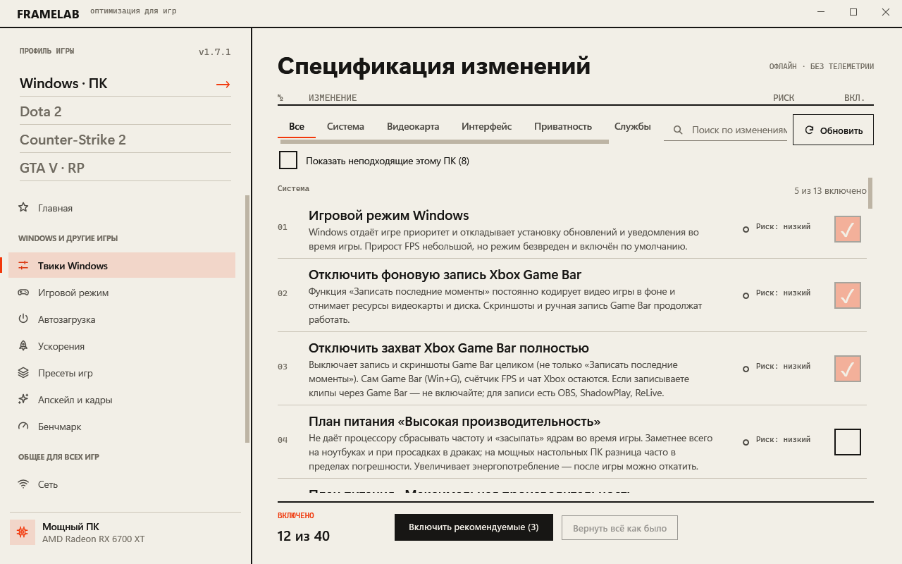

# FrameLab

**Настройки Windows и игр, диагностика и сравнение производительности в одном приложении.**

  
  
  
  

  
  
  

Счётчик показывает суммарные скачивания файлов всех релизов, включая установщик и portable, а не число уникальных пользователей. Данные автоматически обновляются через [Shields.io](https://shields.io/badges/git-hub-downloads-all-assets-all-releases); из-за кеширования новые загрузки отображаются с задержкой.

Бесплатно, без регистрации, рекламы, телеметрии и автоматических обновлений приложения. Прирост FPS зависит от игры и компьютера — проверяйте результат замером.

[Быстрый старт](#быстрый-старт) · [Возможности](#где-что-находится) · [Откат](#откат-и-данные) · [Помощь](#помощь-и-документация) · [Сообщить о проблеме](https://github.com/Derposd/v60/issues/new)

## Что нового в 1.7.1

- Единая навигация во всём приложении: слева всегда **Windows · ПК**, **Dota 2**, **Counter-Strike 2** и **GTA V · RP**.
- При запуске выбран **Windows · ПК**, открыта страница твиков Windows.
- Счётчик включённых настроек, рекомендации и общий откат находятся внизу страницы твиков. При переходе между разделами боковое меню сохраняется.
- В версии 1.7 интерфейс переработан в стиле спецификации: тёплый светлый фон, крупные заголовки, разделители и квадратные переключатели.

Подробности — в [описании релиза 1.7.1](https://github.com/Derposd/v60/releases/tag/v1.7.1).

## Быстрый старт

1. Скачайте **FrameLab-Setup.exe** и установите приложение. Для запуска без установки используйте **FrameLab.exe**. Отдельно устанавливать .NET не нужно.
2. Откройте FrameLab. Стартовая страница — **Windows · ПК → Твики Windows**. У каждой настройки указаны назначение, риск и применимость к вашему ПК.
3. Для Dota 2 или CS2 выберите игру слева и пройдите мастер: **Сканирование → Диагноз → План → Применение**. Для GTA V · RP откройте **Режимы графики**.
4. Перед применением прочитайте список изменений. Сначала выберите несколько подходящих настроек, затем сравните результат в бенчмарке или той же сцене игры.
5. Если результат не устраивает, используйте отмену конкретного изменения или раздел **Откат**.

Установка по умолчанию доступна текущему пользователю. Для системных изменений приложение запрашивает права администратора по мере необходимости.

## Где что находится

| Профиль | Возможности |
|---|---|
| **Windows · ПК** | Твики Windows, игровой режим, автозагрузка, разовые ускорения, пресеты других игр, апскейл и бенчмарк. |
| **Dota 2** | Мастер настройки графики и параметров запуска, поиск причин проблем, монитор матча и диагностика вылетов. |
| **Counter-Strike 2** | Отдельный мастер для CS2, рекомендации, проблемы, мониторинг и диагностика. |
| **GTA V · RP** | Режимы графики через `settings.xml`, установка графических паков с копией исходных файлов, диагностика. |

**Общие разделы:** Главная, Сеть, Откат, Настройки и О программе. На главной доступны состояние ПК и оптимизация установленных игр с предварительным просмотром изменений. В настройках можно уменьшить анимации или включить режим производительности интерфейса.

### Инструменты Windows · ПК

| Раздел | Для чего |
|---|---|
| **Твики Windows** | Отдельные переключатели для системы, графики, интерфейса, приватности, служб и сети. Есть поиск, категории и показ неподходящих настроек. |
| **Игровой режим** | Настройки на время игры: выбранные фоновые программы и службы, приоритет процесса, восстановление после игровой сессии. |
| **Автозагрузка** | Включение и отключение запуска программ вместе с Windows без удаления их записей. |
| **Ускорения** | Разовые действия: временные файлы, кеши и другие операции. Их назначение и ограничения описаны перед запуском. |
| **Пресеты игр** | Настройки Fortnite, Valorant, Minecraft Java и Apex Legends через существующие файлы конфигурации. |
| **Апскейл и кадры** | Возможности видеокарты, помощь с Magpie и Lossless Scaling, установка OptiScaler для подходящих одиночных игр. |
| **Бенчмарк** | Встроенная 3D-сцена без запуска игры и отдельный замер реальной игры через PresentMon. |

## Как сравнивать производительность

**Синтетический тест** запускает встроенную сцену на 30 секунд и сохраняет FPS, 1% low и время кадра. Он помогает сравнить настройки на одном ПК, но не предсказывает FPS в Dota 2, CS2 или GTA V. Показания могут ограничиваться частотой экрана.

**Замер игры** использует PresentMon, встроенный в файлы официального релиза. Для сравнения «до/после» повторяйте одну сцену с одинаковыми настройками и похожей фоновой нагрузкой. Смотрите не только на средний FPS, но и на просадки и время кадра.

## Откат и данные

Перед изменением поддерживаемых файлов и системных значений FrameLab сохраняет исходное состояние. Откат возвращает сохранённые пользовательские значения, а не произвольные настройки по умолчанию.

- Для отдельного изменения используйте его кнопку отмены или выключение соответствующего твика.
- Для всех сохранённых изменений откройте **Откат → Откатить всё**. На странице твиков также есть кнопка **Вернуть всё как было**.
- Разовые операции вроде удаления временных файлов не восстанавливаются из бэкапа — читайте описание действия.
- Точка восстановления Windows зависит от настроек защиты системы и ограничений Windows. Она дополняет собственные копии приложения.

Данные, журнал и резервные копии хранятся в `%LOCALAPPDATA%\Dota2Optimizer`. Название папки сохранено от прежнего Dota 2 Optimizer. Доступ к журналу есть в разделе **О программе**, к копиям — в **Откат**. При удалении приложения эта папка сохраняется.

Для обновления скачайте новый установщик и установите поверх прежней версии. Для portable замените исполняемый файл после закрытия приложения. Не удаляйте папку данных, если нужны история и откат.

## Интернет и ограничения

Основные настройки, диагностика и встроенный тест работают локально. Сетевые проверки, DNS-тесты и загрузка внешних инструментов используют интернет при запуске соответствующих действий. Ссылки на официальные ресурсы открываются в браузере.

FrameLab не обещает одинаковый эффект от твиков на разных ПК. Не отключает Defender, обновления Windows или UAC, не разгоняет железо и не меняет BIOS. Менеджер редуксов GTA блокирует скрипты, ASI и DLL; правила графических модификаций определяет конкретный RP-проект. OptiScaler — отдельный инструмент для одиночных игр, его установка блокируется при обнаруженном античите.

## Помощь и документация

- [Сообщить об ошибке или предложить функцию](https://github.com/Derposd/v60/issues/new). Укажите версию FrameLab, сборку Windows, профиль игры, шаги и ожидаемый результат. Если прикладываете лог, проверьте его на личные данные и пути.
- [FPS в GTA RP](https://derposd.github.io/v60/gta-5-rp/) · [Установка редукса](https://derposd.github.io/v60/reduksy-gta-5-rp/) · [Задержка в CS2](https://derposd.github.io/v60/cs2-input-lag/) · [FPS в Dota 2](https://derposd.github.io/v60/dota-2-fps/).
- [Сборка и структура проекта](docs/BUILD.md).
- [Проверки и сценарии тестирования](docs/TESTING.md).
- [Сторонние компоненты и лицензии](THIRD-PARTY-NOTICES.md).

Текущая реализация: **C# / .NET 8 / WPF**, установщик **Inno Setup**. Исходный код приложения, тесты и статический сайт находятся в этом репозитории.
